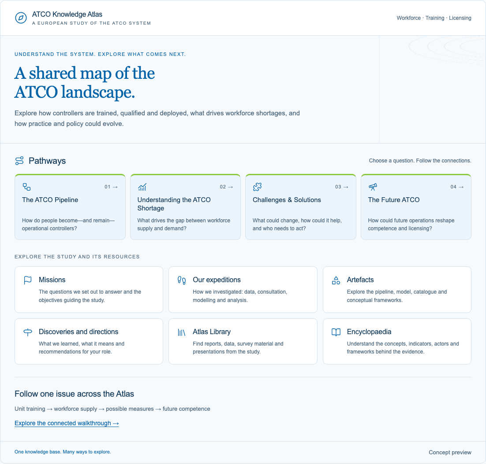

# ATCO Knowledge Atlas demo

A working static example of the Atlas with the demo content already developed. It combines the current Integra blue/green front page with the earlier topic-level demonstration. The four Pathways, six study/resource sections, topics and reference entries are linked HTML pages, so their URLs can be shared and refreshed directly.



## Open the demo

Open **`docs/index.html`** in a browser. The whole demo works directly from disk, including navigation and icons. No installation, build, database, account or API key is required.

To serve it locally instead, run this from the repository folder with Python 3 installed:

```sh
python3 -m http.server 8000 --directory docs
```

Then open <http://localhost:8000>.

## Put it on GitHub Pages

1. Create a repository, for example `atco-knowledge-atlas-demo`.
2. Extract this package and upload or commit the **contents of the `atlas-demo` folder** to the repository root. Keep the `docs` folder and its contents together, including `.nojekyll`.
3. In the repository, go to **Settings → Pages**.
4. Under **Build and deployment**, select **Deploy from a branch**. Choose the branch containing these files (usually `main`) and the **`/docs`** folder, then save.
5. Once GitHub finishes publishing, use **Visit site** in the Pages settings. For a normal project repository, the URL is `https://YOUR-ACCOUNT.github.io/YOUR-REPOSITORY/`.

These instructions use GitHub's branch publishing option, so no custom Actions workflow or build service is needed. GitHub Pages availability depends on the account/repository plan and the organisation's policy. See [GitHub's publishing-source instructions](https://docs.github.com/en/pages/getting-started-with-github-pages/configuring-a-publishing-source-for-your-github-pages-site).

For any other web host, copy **only the contents of `docs/`** to the desired web directory. All page and asset links are relative, so deployment under a subdirectory works as well as deployment at a domain root.

## Included demo pages

- Homepage
- The ATCO Pipeline
- Understanding the ATCO Shortage
- Challenges & Solutions
- The Future ATCO
- Missions
- Our expeditions
- Artefacts
- Discoveries and directions
- Atlas Library
- Encyclopaedia

Beyond the front page and ten section pages, the package includes:

- **37 proposed topic modules**, reached through the four Pathways.
- **Five worked examples:** unit training, workforce supply, measures and practices, the three competency domains, and licensing and recognition options.
- **Eight shared reference entries**, including the study source records.
- **A connected walkthrough** following unit training across four perspectives.

There are **57 ready-to-host HTML pages** in total. Text comes from the two existing demonstrations. The worked examples retain their evidence qualifications; the other topic pages are clearly labelled proposed content outlines. The full study articles, report downloads, datasets and executable workforce model are not included. The package contains no private interview records.

## Files

```text
docs/             Ready-to-host website (57 HTML pages and local assets)
src/              Editable homepage, section/topic/reference data, styles and icons
tools/build.py    Optional generator using only Python 3 standard library
tools/check.py    Optional static page/link checks
reference/        Both original standalone previews, unchanged, with CSP and sandbox
third-party/      Lucide icon licence and Feather attribution
preview.png       Screenshot used above
LICENSING.md      Notes on Atlas materials, branding and third-party icons
```

## Edit the demo

For simple changes, edit the HTML or CSS in `docs/` and publish the changed files. This needs no tools.

For repeated changes, edit `src/sections.json` (section previews), `src/topics.json` (topics, examples and references), `src/home.html` or `src/atlas.css`, then regenerate and check:

```sh
python3 tools/build.py
python3 tools/check.py
```

The generator overwrites the corresponding files in `docs/`. Choose either direct edits or source regeneration for a particular change so you do not overwrite your edits accidentally. To add a section, add its record to `src/sections.json` and a card in `src/home.html`; the generator creates its page automatically.

## Technical characteristics

- Plain HTML and CSS; all navigation works without JavaScript.
- Local inline SVG icons and system fonts; no CDN, analytics, cookies or external network calls.
- Relative paths work on a project URL, subdirectory or local filesystem.
- Responsive light/dark layouts, keyboard focus, labelled links, breadcrumbs and a skip link.
- A restrictive Content Security Policy is included in each generated page. A host may add compatible HTTP security headers.
- Publishing/editing access is managed through the repository or host, outside the public website.

Both original reference HTML files remain untouched in `reference/`. The deployable example uses ordinary pages and does not depend on the original iframe wrappers, ChatGPT widget state or Sites. `reference/` is outside the Pages publishing folder.
